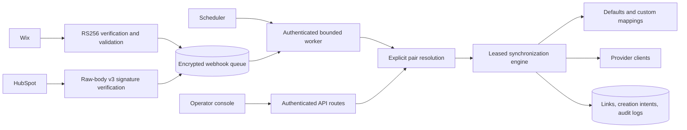

# Architecture

The existing Next.js App Router, TypeScript, Supabase/PostgreSQL and provider REST
architecture is retained. No separate broker or application framework was introduced.

## Source map

| Layer | Location | Responsibility |
|---|---|---|
| Dashboard | `src/app/page.tsx` | Operator login, connection selection, pairing, mappings, manual sync and status |
| HTTP routes | `src/app/api` | Authentication, input validation and safe responses |
| Provider lifecycle | `src/lib/providers/connections.ts`, `hubspot/oauth.ts`, `wix/client.ts` | Encrypted credentials, installation token generation, OAuth and disconnection |
| Provider contracts | `src/lib/providers/{wix,hubspot}` | Pagination, normalization, property discovery, revisions and typed API failures |
| Security | `src/lib/security` | Signed sessions, same-origin mutations, AES-GCM encryption, body limits and safe metadata logs |
| Identity and routing | `src/lib/sync/connection-repository.ts`, `creation-intent.ts` | Pair resolution and recovery of uncertain creates |
| Business logic | `src/lib/sync` | Mapping, conflict checks, echo checks, leases, link persistence and audit records |
| Queue | `src/lib/webhooks` | Verification, canonical idempotency keys, encrypted storage, claims, processing and retry classification |
| Storage | `supabase/migrations` | Versioned constraints, RLS, privileged functions and state transitions |
| Verification | `tests`, `src/sync/*.test.ts`, `scripts/smoke.mjs` | Unit, SQL-backed integration, provider HTTP contracts, security, browser and production HTTP checks |

## Pairing and ownership

Every contact link and mapping uses both connection IDs. `integration_pairs` defines
allowed routes; shared endpoints are supported. Inbound events fan out over configured
active pairs. Unpaired or ambiguous manual resolution fails safely. Historical links
survive disconnects. Pair endpoints cannot be changed in place.

The root operator console retains privileged global access. The optional `/customer`
workspace uses verified Supabase Auth users, active tenant membership and explicit
resource checks in a separate `/api/customer` namespace. Owner/admin roles can mutate;
viewers can read. Provider endpoints must share ownership; disabled tenants and
partially adopted legacy pairs fail closed. Browser roles have no integration-table
access. Customer access remains disabled by default pending staging acceptance.
See `TENANCY-DESIGN.md` for onboarding proofs and atomic ownership adoption.

## Data integrity

Stable provider IDs are the permanent identity; email is only an initial lookup key.
Pair-scoped unique constraints reject conflicting links. Before creating, a durable
intent reserves the source ID and encrypted original lookup email. Uncertain provider
writes reconcile a remembered destination ID or original email, and never blindly
repeat creation. Unresolved outcomes require operator investigation.

Installation and shared-portal leases serialize application writes. Ownership checks,
deadlines and queue lease versions fence stale workers. They cannot cancel writes
already accepted by an external provider.

## Mapping and conflict policy

Partial custom mappings merge with standard fields. Disabled/default one-way fields
are masked in the opposite direction. Missing, null and blank custom values do not
clear meaningful data unless `allowEmpty` explicitly permits it. A saved empty mapping
set disables writes; unsaved new pairs use defaults.

Current provider snapshots determine last-write-wins; HubSpot wins equal timestamps.
Timestamp parsing normalizes time zones to milliseconds; a known timestamp wins over
an unknown one, with deterministic HubSpot fallback when both are unknown. Reciprocal
echo detection requires the stored provider-returned timestamp, not a broad time window.
Wix revision checks protect writes. HubSpot gets a final target timestamp preflight,
but an external edit racing PATCH remains a documented limitation.

Forms use immutable submission creation time rather than webhook arrival or retry
time. They follow the same contact mapping masks and target version preflight, and
never manufacture `form_submitted_at` when the provider timestamp is unavailable.
Missing ordering information cannot replace an existing HubSpot contact. Their
success audit follows link persistence. All mapping writes use the transactional
replacement API; the unused single-row repository writer was removed.

## Queue lifecycle and limits

Verify before persistence; acknowledge only after durable encrypted insertion.
Canonical idempotency keys include provider/account identity. Fallback payload keys
use locale-independent UTF-16 ordering so Windows and Linux compute the same identity.
Claims are atomic SQL
operations; completion checks independent monotonically increasing lease versions.
Five attempts, bounded backoff, Retry-After and permanent-error terminalization prevent
infinite retries. Expired processing leases are reclaimed or finalized when exhausted.
Workers are sequential, bounded to five dispatch candidates, with a shared four-minute
work deadline. Throughput and production multi-process behavior require staging tests.
